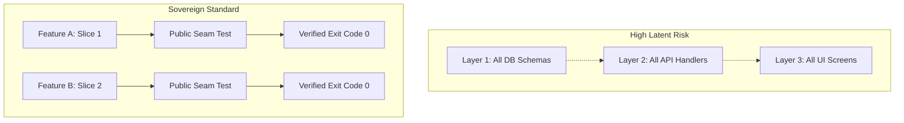

# 🧪 FLOWORK SOVEREIGN ENGINEERING DOCTRINE: TEST-DRIVEN DEVELOPMENT (TDD)

> **Classification**: Production Verification Standard  
> **Authority**: Super Admin AWENKAUDICO & TEGUHFX (Level 99)  
> **Core Doctrine**: Red-Before-Green, Vertical Tracer Bullets, Anti-Tautological Rigor  

---

## 1. THE RED-BEFORE-GREEN IMPERATIVE

In the Flowork OS ecosystem, no implementation code may be authored or modified without an existing, reproducible failing test (Red State).

### 1.1 The Falsifiability Rule
- **A test that cannot fail cannot prove success.**
- Before writing production code, execute the test runner to observe the exact expected failure mode:
  - Verify that the test fails for the *intended semantic reason* (e.g., missing method, incorrect status code, invariant violation) and NOT because of a compilation crash, syntax syntax error in the test file, or an unresolvable import.
- Only once the failing test cleanly asserts the absence of the desired capability do you write the minimal code required to transition the test to green (Exit Code 0).

### 1.2 Anti-Tautological Verification
- **Tautological Tests**: Tests that test the mock rather than the system, or assert conditions guaranteed by the programming language's type system rather than business logic.
- **Rules of Engagement**:
  - Never mock the system under test.
  - Never write tests that merely assert that a mocked dependency was invoked with the arguments supplied to it, unless message transmission is the sole contract.
  - Assert on state mutations, return values, deterministic I/O payloads, and system invariants.

---

## 2. VERTICAL TRACER BULLETS VS. HORIZONTAL SLICING

### 2.1 The Failure of Horizontal Slicing
Horizontal layering (building the entire database schema, then all API endpoints, then all UI views before verifying end-to-end flow) creates massive latent failure surfaces:
- Integrations fail late in the development cycle.
- Hidden assumptions across layers compound silently.
- Large diffs make regressions difficult to trace and isolate.

### 2.2 Vertical Tracer Bullets
Instead of horizontal layers, engineer vertically sliced "tracer bullets":
1. Take one narrow, concrete user capability (e.g., "Authenticate with token and retrieve active workspace metadata").
2. Implement and test that slice through the complete stack:
   - External API input -> Ingestion validation -> Internal domain handler -> Persistence -> Output payload.
3. Verify the complete vertical circuit with a single integration test before expanding to adjacent capabilities.

---

## 3. PUBLIC SEAMS & TEST STABILITY

### 3.1 What is a Public Seam?
- A **Public Seam** is a documented, stable interface boundary where internal behavior expresses itself externally (e.g., an exported class method, a CLI command, an IPC handler, an HTTP endpoint).
- Tests must couple exclusively to public seams, NEVER to internal implementation details, private methods, or ephemeral variables.

### 3.2 Refactoring Resilience
- When private methods or internal algorithms are refactored, tests coupled to public seams continue passing without modification.
- If a refactoring requires modifying existing tests without changing the external behavior of the system, the tests were coupled to the wrong abstraction.

---

## 4. TDD EXECUTION RUNBOOK (STEP-BY-STEP)

1. **Step 1: Identify Public Seam**: Choose the exact entry point and target behavior.
2. **Step 2: Write Minimal Failing Test**: Construct a unit/integration test asserting the desired behavior.
3. **Step 3: Run Test (Observe Red)**: Execute the test command in the terminal. Verify the specific failure message matches expectation.
4. **Step 4: Implement Minimal Solution**: Write only the code required to satisfy the test. Avoid premature optimization or unrequested features.
5. **Step 5: Run Test (Observe Green)**: Execute the test command. Verify status Exit Code 0.
6. **Step 6: Refactor with Safety Net**: Clean up structure, improve readability, eliminate Fowler smells. Verify all tests remain green.
