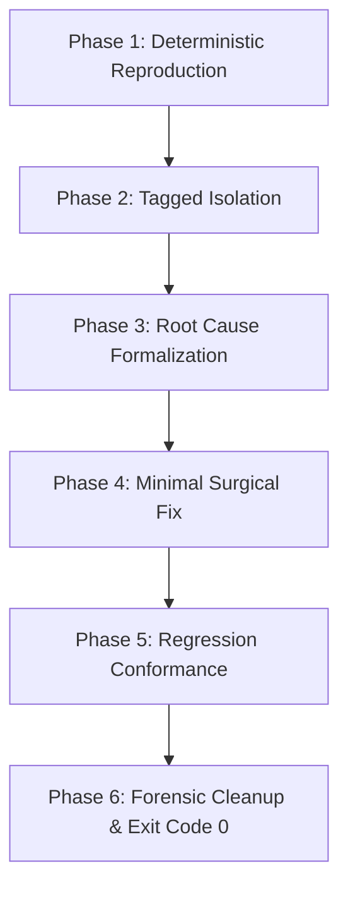

# 🩺 FLOWORK SOVEREIGN ENGINEERING DOCTRINE: DIAGNOSING BUGS & ANTI-THRASHING

> **Classification**: Production Diagnostic Protocol  
> **Authority**: Super Admin AWENKAUDICO & TEGUHFX (Level 99)  
> **Core Doctrine**: Zero-Code-Change Until Red-Capable Loop, Tagged Instrumentation, Anti-Thrashing Circuit Breaker  

---

## 1. THE GOLDEN RULE OF BUG DIAGNOSIS

> [!CRITICAL]
> **HARAM TO TOUCH PRODUCTION CODE BEFORE A REPRODUCIBLE FAILING LOOP EXISTS.**  
> Attempting to "fix" a bug without first reproducing it deterministically is mere blind thrashing that introduces secondary regressions.

---

## 2. THE 6-PHASE DIAGNOSTIC PROTOCOL

### Phase 1: Deterministic Reproduction
- Formulate a single, self-contained shell command, test case, or script that triggers the exact reported bug with 100% repeatability.
- If the bug is intermittent or race-condition based, construct a loop harness (`for i in {1..50}; do ...; done`) to force the race into an observable failure state.
- **Do not proceed to Phase 2 until you can produce the failure on demand.**

### Phase 2: Tagged Instrumentation
- When data flow across functions or processes is ambiguous, insert temporary tagged logging statements:
  - Format: `[DEBUG-xxxx] variable_name: value` (where `xxxx` is a random 4-character identifier unique to this debugging session).
- **Why Tagged?**
  - Uniquely identifiable tags prevent confusing debug prints with normal system logs.
  - Enables single-command forensic cleanup (`grep -rn "DEBUG-xxxx" .`) so temporary instrumentation never leaks into production releases.

### Phase 3: Root Cause Formalization
- Trace the defect to its fundamental causal mechanism (e.g., integer overflow, unhandled null boundary, asynchronous event order inversion, unescaped path delimiter).
- Distinguish between **the symptom** (e.g., HTTP 500 error) and **the root cause** (e.g., regex catastrophic backtracking on unvalidated header).

### Phase 4: Minimal Surgical Fix
- Write the smallest possible change that resolves the root cause.
- Avoid incidental refactoring, cosmetic variable renames, or unrelated optimizations during a bug fix turn. Keep diffs laser-focused.

### Phase 5: Regression Conformance
- Ensure the reproduction harness from Phase 1 is codified into a permanent regression test suite.
- Verify that the test transitions from Red to Green (Exit Code 0).
- Run the full test suite to guarantee that zero adjacent systems were broken by the fix.

### Phase 6: Forensic Cleanup & Hygiene
- Remove all `[DEBUG-xxxx]` prints, temporary scratch files, and debug flags.
- Confirm clean workspace git status before declaring resolution.

---

## 3. THE ANTI-THRASHING CIRCUIT BREAKER

### 3.1 The Thrashing Trap
- **Thrashing** occurs when an engineer makes multiple speculative changes in rapid succession, hoping one will accidentally solve the bug.
- Indicators of thrashing:
  - Changing code based on "intuition" without observing logs.
  - Adding multiple layers of defensive `try/catch` blocks that swallow errors.
  - Two consecutive attempted fixes that fail to resolve the issue.

### 3.2 Circuit Breaker Rule
If two consecutive fix attempts fail to make the test green:
1. **FULL STOP**: Revert the working tree to the last known stable state.
2. **Discard All Hypotheses**: The mental model of the failure is provably wrong.
3. **Step Back to Phase 1**: Re-read the source code from scratch, inspect environment variables, verify system dependencies, and trace data flow from first principles.
