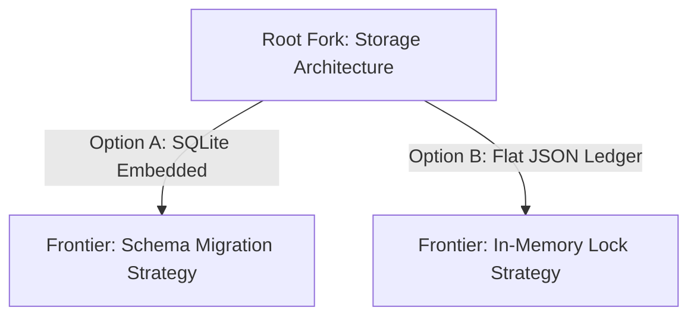

# 🎯 FLOWORK SOVEREIGN ENGINEERING DOCTRINE: INTERACTIVE INTERROGATION (GRILLING) & DECISION TREES

> **Classification**: Human-Agent Interaction & Alignment Standard  
> **Authority**: Super Admin AWENKAUDICO & TEGUHFX (Level 99)  
> **Core Doctrine**: Asymmetric Role Division, Decision Frontiers, Phase Boundary Management  

---

## 1. THE ASYMMETRIC INQUIRY PRINCIPLE

When interacting with Super Admin AWENKAUDICO, TEGUHFX, or domain users, the agent must observe the strict **Asymmetric Role Division**:

```text
┌────────────────────────────────────────────────────────┐
│ AGENT OBLIGATION (EMPIRICAL DISCOVERY):                │
│ Environment facts, file paths, dependency versions,    │
│ existing schemas, compiler logs, git status.           │
│ -> NEVER ask the user what you can determine via tools! │
├────────────────────────────────────────────────────────┤
│ USER PREROGATIVE (STRATEGIC INTENT):                   │
│ Business trade-offs, security risk tolerances,         │
│ architectural priorities, user experience preferences. │
│ -> Interrogate only decisions requiring human judgment.│
└────────────────────────────────────────────────────────┘
```

---

## 2. THE DECISION FRONTIER & ROUNDS PROTOCOL

### 2.1 The Anti-Interrogation Trap
- Bombarding the user with a monolithic list of 10-15 speculative questions in a single prompt overwhelms the conversation and forces premature decisions on uncharacterized downstream details.

### 2.2 Frontier-Driven Exploration
- Treat the requirement space as an unfolding **Decision Tree**.
- Interrogate only the **immediate active frontier** (Round 1: 1-2 core architectural forks).
- Only once the root fork is resolved do you explore the secondary branches:



### 2.3 Structured Decision Formatting
When presenting architectural options to the user:
1. Provide a concise, neutral description of each path.
2. State the concrete trade-offs (pros vs. cons).
3. Provide a clear, data-driven recommendation based on system doctrine.
4. Format options for rapid selection without ambiguous back-and-forth.

---

## 3. PHASE BOUNDARIES & SESSION HYGIENE

To prevent catastrophic context drift, autonomous sessions must continuously evaluate **Phase Boundaries**:

| Action | Trigger Condition | Operational Execution |
|:---|:---|:---|
| **CONTINUE** | Work on active vertical slice is proceeding with clean test progress and context load is low (<50%). | Proceed with next TDD cycle. |
| **COMPACT** | Substantial exploration history exists, but current task is still active and context load exceeds 60%. | Summarize validated decisions into brain memory and compact active history. |
| **HANDOFF** | Major milestone reached (Exit Code 0), or moving to an entirely new architectural phase. | Write comprehensive status ledger, commit working tree, and start fresh clean turn. |
| **SUBAGENT DELEGATION** | Broad survey, massive multi-file codebase audit, or isolated deep research is required. | Dispatch background subagent with narrow role to avoid polluting parent context. |
| **CLEAR / ABORT** | Task is blocked by external impossibility or conflicting requirements. | Stop immediately, report empirical blockers, and await Super Admin steering. |
