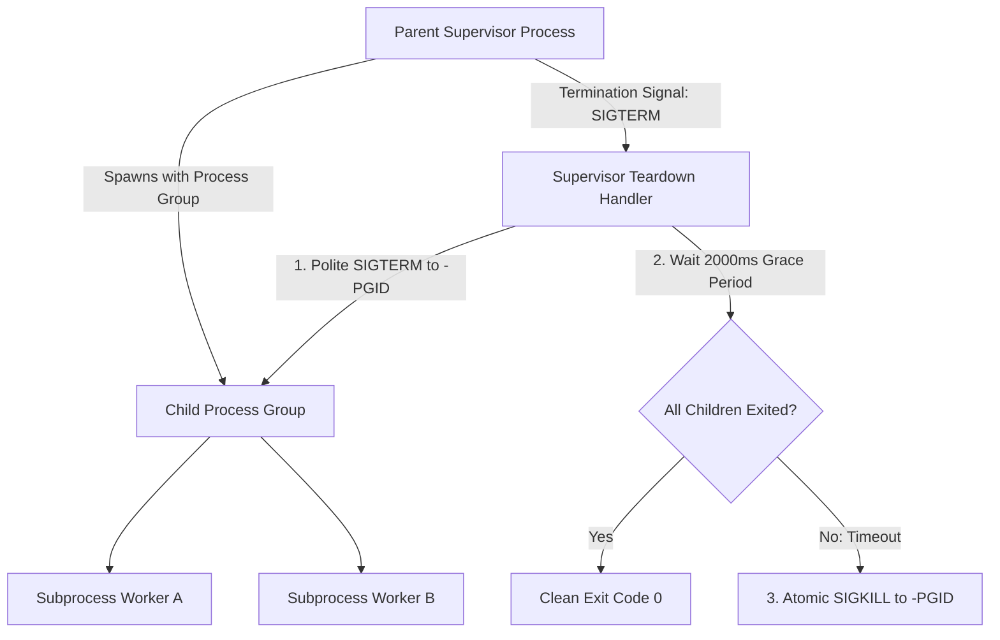

# 🔒 FLOWORK SOVEREIGN SECURITY DOCTRINE: PROCESS & KERNEL-LEVEL ISOLATION

> **Classification**: Production OS Hardening & Concurrency Containment  
> **Authority**: Super Admin AWENKAUDICO & TEGUHFX (Level 99)  
> **Core Doctrine**: Hard Resource Ceilings, Zero-Orphan Guarantee, Anti-TOCTOU Path Pinning  

---

## 1. BOUNDED RESOURCE BUDGETS & KERNEL CEILINGS

Untrusted workloads, subagent tasks, and third-party plugins must NEVER run without strict operating system resource ceilings. Uncapped execution allows malicious or buggy code to exhaust system memory, starve the CPU, and induce kernel panics (*Denial of Service*).

### 1.1 Linux Kernel Enforcement (cgroups v2 & `prlimit`)
When spawning background subworkers or tool processes on Linux:
- **Virtual Memory Ceiling (`RLIMIT_AS`)**: Cap address space allocation (e.g., 1 GiB per analyzer process) to immediately neutralize decompression bombs, zip bombs, and heap exhaustion attacks.
- **CPU Time Ceiling (`RLIMIT_CPU`)**: Set hard compute timeouts (e.g., 30-60 seconds CPU time) to abort runaway regex backtrackers and infinite execution loops.
- **Output File Size Limit (`RLIMIT_FSIZE`)**: Prevent rogue processes from filling physical storage disks (e.g., 64 MiB output ceiling).
- **Core Dump Suppression (`RLIMIT_CORE=0`)**: Prevent sensitive memory contents from being dumped unencrypted to disk upon crash.

### 1.2 Windows Kernel Enforcement (Job Objects)
When running on Windows:
- Assign all child processes to a dedicated Windows Job Object configured with:
  ```c
  JOBOBJECT_EXTENDED_LIMIT_INFORMATION jeli = {0};
  jeli.BasicLimitInformation.LimitFlags = JOB_OBJECT_LIMIT_KILL_ON_JOB_CLOSE | JOB_OBJECT_LIMIT_DIE_ON_UNHANDLED_EXCEPTION;
  ```
- **The Invariant**: If the supervisor or parent process terminates (gracefully or via crash), the Windows kernel atomically terminates all descendant child processes, preventing leaked background zombies.

---

## 2. THE ZERO-ORPHAN / ANTI-ZOMBIE GUARANTEE



### 2.1 Process Group Tracking
- Every child subprocess must be spawned inside its own process group (`setpgid(0, 0)` in POSIX).
- Keep an explicit registry of active process group IDs.

### 2.2 Deterministic Teardown Sequence
1. **Signal Propagation**: Send `SIGTERM` to the entire negative process group (`-pgid`), allowing cooperative processes to flush logs and close file handles.
2. **Grace Timeout**: Await exit status up to a strict timeout (e.g., 2000 ms).
3. **Forced Termination**: If any descendant process remains alive past the grace period, issue `SIGKILL` to the entire group.
4. **Post-Cleanup Verification**: Query the system process table to confirm complete eradication before reporting completion.

---

## 3. ANTI-TOCTOU & PATH PINNING LOCKDOWN

### 3.1 The Time-of-Check to Time-of-Use (TOCTOU) Hazard
- A TOCTOU vulnerability occurs when an application checks if a file path is safe (e.g., checking that it does not contain `..` or point to a symlink), but an attacker swaps the path (via symlink racing or directory junction) before the application actually opens the file.

### 3.2 Hardened Path Resolution Rules
1. **Canonicalization Before Validation**: Always resolve paths to their physical, canonical target (`realpath` in POSIX, `GetFinalPathNameByHandle` in Windows) before performing permission checks.
2. **Strict Root Containment**:
   ```typescript
   const resolvedPath = path.resolve(workspaceRoot, userInputPath);
   if (!resolvedPath.startsWith(workspaceRoot + path.sep)) {
     throw new SecurityViolationError("Path traversal escape detected");
   }
   ```
3. **Block Reserved System Names**: Reject Windows reserved device names (`CON`, `PRN`, `AUX`, `NUL`, `COM1-9`, `LPT1-9`) and NTFS Alternate Data Streams (`::$DATA`).
4. **File Handle Pinning**: In multi-tenant environments, open the file once and operate exclusively through the acquired file descriptor handle, preventing post-check filesystem swaps.
